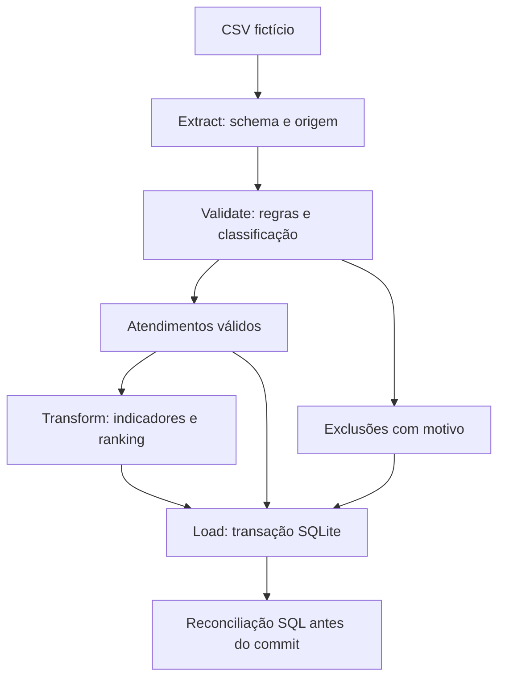

# Pandas Support Analytics

**Pipeline ETL local com Python, pandas e SQLite para transformar atendimentos em indicadores auditáveis.**

O case aplica regras de qualidade, registra cada exclusão, calcula o desempenho por atendente e carrega os resultados em banco dentro de uma transação. O reprocessamento substitui somente a competência solicitada. Todos os dados demonstrativos são fictícios.

Na amostra de referência: **18 entradas → 10 válidos + 8 excluídos**, com **9 avaliações válidas e 90% de cobertura**. Na amostra de qualidade: **22 entradas → 10 válidos + 12 excluídos**, exercitando também duplicados, protocolo ausente e outra competência.

## O problema e a decisão

Uma exportação pode conter outros departamentos, atendentes ausentes, datas inválidas e avaliações fora da escala. O objetivo é decidir **quais atendimentos podem entrar nos indicadores e explicar o tratamento de cada registro**.

Exemplo: uma nota 8 em uma escala de 0 a 5 fica fora da média. O atendimento continua válido quando passa nas demais regras; a ausência da avaliação aparece na cobertura de respostas.

## Executar em poucos minutos

Requisito: **Python 3.12**. Na raiz do repositório:

```bash
python -m venv .venv
```

Windows PowerShell:

```powershell
.venv\Scripts\Activate.ps1
```

Linux/macOS:

```bash
source .venv/bin/activate
```

Instale as dependências e execute:

```bash
python -m pip install -r requirements.txt
python -m etl
python -m etl --reconcile-only
```

Saída da primeira execução:

```text
extract   entrada=18  saida=18  excluidos=0  (atendimentos)
validate  entrada=18  saida=10  excluidos=8  (atendimentos)
transform entrada=10  saida=3               (atendimentos -> atendentes)
load      linhas persistidas=21            (10 válidos + 8 excluídos + 3 rankings)
reconciliado=1
```

O banco fica em `resultados/etl/suporte.sqlite`. CSVs, manifesto com hash da entrada e [resumo da execução](resultados/etl/RESUMO.md) ficam na mesma pasta. O banco é gerado localmente e não é versionado.

## Etapas e evidências



| Competência demonstrada | Onde conferir |
|---|---|
| Contrato de entrada, preservação de identificadores e SHA-256 | [extract.py](etl/extract.py) |
| Uma função por regra, máscaras booleanas e auditoria | [validate.py](etl/validate.py) |
| `groupby().agg()`, quantis e pontuação vetorizada | [transform.py](etl/transform.py) |
| Carga parametrizada, rollback e substituição mensal | [load.py](etl/load.py) |
| Contagens e execução das etapas | [pipeline.py](etl/pipeline.py) |
| Reconciliação diretamente no banco | [reconciliar.sql](sql/reconciliar.sql) |
| Testes de negócio, equivalência, reprocessamento e falhas | [test_etl.py](tests/test_etl.py) |

### Regras de qualidade

- Cabeçalhos ausentes, extras ou duplicados e linhas com quantidade incorreta de campos bloqueiam o arquivo antes da carga.
- Cada atendimento recebe um único motivo principal, conforme a prioridade documentada.
- Protocolos repetidos, após remoção de espaços externos e comparação sem distinção de maiúsculas, ficam **todos em quarentena na mesma competência inicial**. Nenhuma cópia é escolhida arbitrariamente.
- Protocolo em branco e registros de outra competência são auditados como exclusões, sem desaparecimento silencioso de linhas.
- A competência vem do início: um atendimento encerrado no mês seguinte pode permanecer no mês inicial.
- A avaliação inválida fica ausente na média e na contagem de respostas; não elimina automaticamente o atendimento.

## Validar e reproduzir

```bash
python scripts/verificar_codigo.py
python scripts/verificar_etl.py
```

O primeiro comando confere os hashes de oito arquivos preservados e roda seis testes originais. O segundo roda os testes da pipeline modular, compara os 18 campos do ranking com a referência original e gera as duas demonstrações em SQLite. Consulte o [registro da execução](resultados/VALIDACAO_ETL.md).

O [workflow de CI](.github/workflows/ci.yml) executa os comandos em Linux e Windows, com Python 3.12. Os resultados e bancos demonstrativos são disponibilizados como artefatos do GitHub Actions. Os [runs](https://github.com/Pedroferreira32/pandas-support-analytics-case/actions) mostram o estado da execução remota.

Para executar somente os testes novos:

```bash
python -m unittest discover -s tests -v
```

## O que foi implementado neste case

A implementação modular em `etl/`, o contrato CSV, a quarentena de duplicados, a carga em SQLite, os controles SQL, a CLI e os testes de integração foram acrescentados neste repositório. O ranking foi reimplementado com agregações nomeadas e comparado ao resultado do motor original; não é um wrapper de `process_upload`.

Os parâmetros históricos de pontuação são reutilizados de `backend/app/pipeline/rules.py`. Os oito arquivos de referência em `backend/` permanecem íntegros e rastreáveis por hashes. A [documentação de evolução](docs/EVOLUCAO_PANDAS.md) explica as diferenças e a [referência anterior](docs/REFERENCIA_PANDAS.md) conserva os detalhes do primeiro recorte.

## Escopo

Este é um ETL local de portfólio, em lote, para o contrato CSV da amostra: UTF-8, separador `;` e datas `DD/MM/AAAA HH:MM`. A carga usa uma transação por competência e mantém o resultado atual de cada mês. Os identificadores de execução e as contagens ficam registrados; não há snapshot de todas as versões anteriores dos registros.

A amostra pequena comprova comportamento e reconciliação. Não foi medido ganho de produtividade, custo ou desempenho. O TMA deste case corresponde à duração entre início e fim; não comprova tempo de trabalho ativo, FCR ou retrabalho. O fluxo não inclui agendamento, fonte remota ou infraestrutura em nuvem.

[Contrato e decisões técnicas](docs/PIPELINE.md) · [Roteiro de demonstração](docs/GUIA_DEMONSTRACAO.md) · [Origem e hashes](docs/origem_codigo.json) · [Projeto completo Performance do Suporte](https://github.com/Pedroferreira32/support-performance-analytics)
