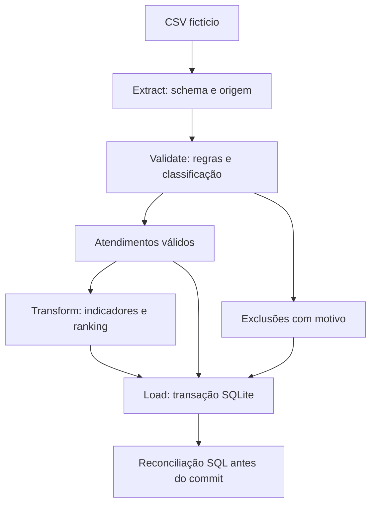

# Pandas Support Analytics

**Implementei uma pipeline ETL modular em Python/pandas, com carga transacional em SQLite, reconciliação SQL e quarentena de duplicados.**

A pipeline principal está em **`etl/`** e é executada com `python -m etl`. Mantive `backend/` como referência histórica para conferir a origem das regras e comparar os resultados da implementação nova.

Ao analisar dados de atendimento, percebi que datas inválidas, avaliações fora da escala e registros de outros departamentos poderiam alterar os indicadores. Por isso, organizei o tratamento em etapas e preservei a explicação de cada exclusão.

Para demonstrar o comportamento, usei duas amostras inteiramente fictícias:

- **Referência:** 18 entradas, 10 atendimentos válidos, 8 excluídos, 9 avaliações válidas e 90% de cobertura.
- **Qualidade:** 22 entradas, 10 atendimentos válidos e 12 excluídos, incluindo protocolos duplicados, protocolo ausente e registros de outra competência.

## O problema que procurei resolver

Eu precisava definir quais atendimentos poderiam participar dos indicadores e tornar essa decisão verificável. Separei a validade do atendimento da validade da avaliação.

Na amostra, incluí uma nota 8 em uma escala de 0 a 5. Desconsiderei essa nota no cálculo da média e na contagem de respostas, mas mantive o atendimento quando ele passou nas demais regras. Assim, a cobertura de avaliações registra a ausência sem eliminar um atendimento válido.

## Como reproduzir minha execução

Usei **Python 3.12** e fixei as versões das dependências principais em `requirements.txt`. Na raiz do repositório, criei o ambiente virtual:

```bash
python -m venv .venv
```

Para ativá-lo no Windows PowerShell, o comando é:

```powershell
.venv\Scripts\Activate.ps1
```

No Linux/macOS, o comando equivalente é:

```bash
source .venv/bin/activate
```

Depois, instalei as dependências, executei a pipeline e consultei a reconciliação no banco:

```bash
python -m pip install -r requirements.txt
python -m etl
python -m etl --reconcile-only
```

Na amostra de referência, obtive estas contagens:

```text
extract   entrada=18  saida=18  excluidos=0  (atendimentos)
validate  entrada=18  saida=10  excluidos=8  (atendimentos)
transform entrada=10  saida=3               (atendimentos -> atendentes)
load      validos=10  excluidos=8  ranking=3  reconciliado=True
```

Gravei os resultados em `resultados/etl/suporte.sqlite` e exportei CSVs, manifesto com hash da entrada e [resumo da execução](resultados/etl/RESUMO.md). Mantive o banco fora do versionamento; ele é recriado pela execução local.

## Como organizei a pipeline



| O que implementei | Onde conferir |
|---|---|
| Contrato de entrada, preservação de identificadores e SHA-256 | [extract.py](etl/extract.py) |
| Uma função por regra, máscaras booleanas e auditoria | [validate.py](etl/validate.py) |
| Agregações nomeadas com `groupby().agg()`, quantis e pontuação vetorizada | [transform.py](etl/transform.py) |
| Carga parametrizada, rollback e substituição mensal | [load.py](etl/load.py) |
| Orquestração e contagens por etapa | [pipeline.py](etl/pipeline.py) |
| Reconciliação diretamente no banco | [reconciliar.sql](sql/reconciliar.sql) |
| Testes de negócio, equivalência, reprocessamento e falhas | [test_etl.py](tests/test_etl.py) |

## Decisões que tomei no tratamento

- Bloqueei arquivos com cabeçalhos ausentes, extras ou duplicados e com quantidade incorreta de campos, antes da carga.
- Defini uma prioridade de regras para atribuir um único motivo principal por exclusão. Registrei também quantas linhas cada regra detectou.
- Coloquei **todas as cópias de um protocolo repetido na mesma competência inicial em quarentena**, após remover espaços externos e comparar sem distinção de maiúsculas. Preferi preservar a ambiguidade para auditoria a escolher arbitrariamente a primeira cópia.
- Registrei protocolos em branco e atendimentos de outra competência como exclusões explícitas.
- Usei a data inicial para determinar a competência. Um atendimento encerrado no mês seguinte pode permanecer no mês em que começou.
- Mantive avaliações inválidas fora da média e da contagem de respostas, preservando os atendimentos que atenderam aos demais critérios.

## Como validei os resultados

Executei os seguintes comandos:

```bash
python scripts/verificar_codigo.py
python scripts/verificar_etl.py
```

Conferi os hashes dos oito arquivos de referência e executei seis testes originais. Acrescentei 27 testes para a pipeline modular, incluindo comparação dos 18 campos do ranking com o motor original, falhas de carga, rollback, reprocessamento e preservação de outras competências. Registrei os resultados em [VALIDACAO_ETL.md](resultados/VALIDACAO_ETL.md).

Também configurei o [GitHub Actions](.github/workflows/ci.yml) para repetir a verificação em Linux e Windows com Python 3.12 e disponibilizar os bancos e relatórios como artefatos. O estado de cada execução pode ser conferido nos [runs](https://github.com/Pedroferreira32/pandas-support-analytics-case/actions).

Para executar somente os testes novos, o comando é:

```bash
python -m unittest discover -s tests -v
```

## O que preservei e o que acrescentei

Implementei em `etl/` a extração, a classificação, o ranking, a carga SQLite e a CLI. Reutilizei os parâmetros históricos de `backend/app/pipeline/rules.py` e comparei a nova agregação com o resultado do motor original.

Preservei os oito arquivos de referência em `backend/`, com seus hashes de origem. Documentei as escolhas em [EVOLUCAO_PANDAS.md](docs/EVOLUCAO_PANDAS.md) e mantive os detalhes do primeiro recorte na [referência anterior](docs/REFERENCIA_PANDAS.md).

## Limites e o que ainda preciso implementar

Construí este projeto como um **ETL local de portfólio**, em lote, com CSV fictício e SQLite. Usei um contrato explícito: UTF-8, separador `;` e datas `DD/MM/AAAA HH:MM`. A carga substitui os dados ativos da competência solicitada e mantém metadados das execuções confirmadas; não preservei snapshots completos das versões anteriores.

Para operar continuamente, ainda preciso implementar:

- **Agendamento e orquestração:** execução periódica, controle de concorrência e política de novas tentativas.
- **Carga incremental:** identificação de registros novos, alterados e removidos, com tratamento de dados que chegam atrasados.
- **Monitoramento e alertas:** acompanhamento de falhas, duração, volumes e desvios de qualidade.
- **Registro de tentativas que falham:** persistência independente da transação dos dados, para que o rollback não elimine a evidência da tentativa.
- **Evolução de schema:** versionamento de contratos e migrações, com validação de compatibilidade.

Validei o comportamento e a reconciliação com amostras pequenas. Não medi ganhos de produtividade, custo ou desempenho. Neste case, calculei o TMA pela diferença entre início e fim; esse valor não comprova tempo de trabalho ativo, resolução no primeiro contato ou retrabalho.

[Contrato e decisões técnicas](docs/PIPELINE.md) · [Como avaliar o projeto](docs/GUIA_DEMONSTRACAO.md) · [Origem e hashes](docs/origem_codigo.json) · [Projeto completo Performance do Suporte](https://github.com/Pedroferreira32/support-performance-analytics)
