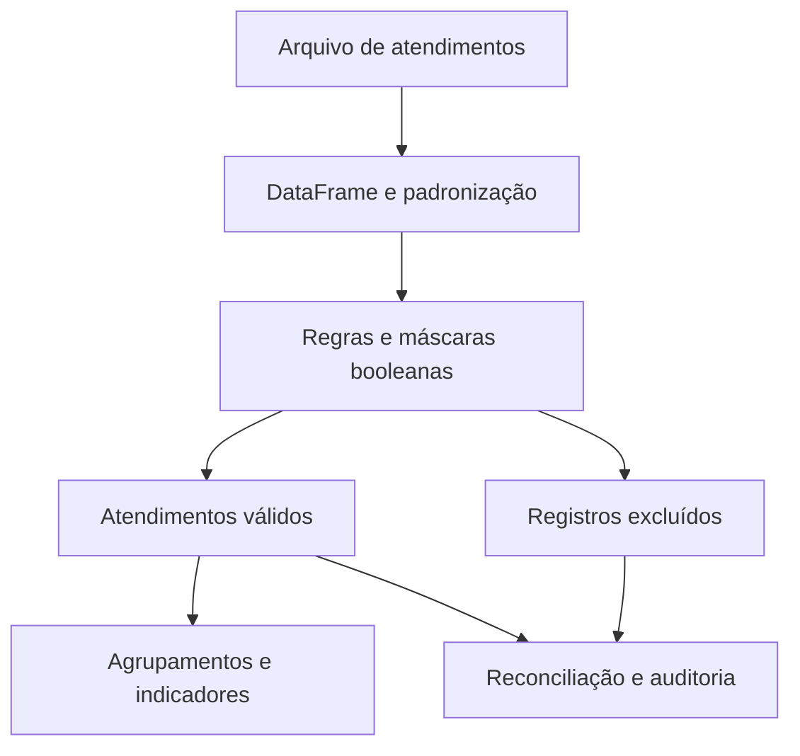

# Pandas Support Analytics

Pipeline de validação e análise de atendimentos com Python e pandas.

**Case técnico do projeto Performance do Suporte**  
Pedro Aurélio Gonçalves Ferreira · Python · pandas · Qualidade de dados · Análise operacional

Este recorte mostra onde o pandas participa da preparação, validação e análise de atendimentos. O código principal foi extraído do repositório público do projeto e pode ser conferido por arquivo, linha e commit. A demonstração executa a função original `process_upload` com uma base inteiramente fictícia.

[Projeto completo](https://github.com/Pedroferreira32/support-performance-analytics) · [Motor pandas original](https://github.com/Pedroferreira32/support-performance-analytics/blob/1c06e62c70b9e2d71908381728f9875a5b7c4dc3/backend/app/pipeline/engine.py) · [Post para LinkedIn](docs/POST_LINKEDIN.md) · [Origem e hashes dos arquivos](docs/origem_codigo.json)

## O problema de negócio

Uma exportação de atendimentos pode misturar departamentos, atendentes ausentes, datas inválidas, encerramentos pendentes e avaliações fora da escala. Esses casos influenciam os indicadores usados no acompanhamento da equipe e na apuração da premiação.

A pergunta que orienta este case é: **quais registros podem entrar no cálculo e como explicar os que ficaram de fora?**

A solução mantém a linha de origem e o protocolo, aplica regras explícitas e produz bases de válidos e excluídos. Os indicadores são calculados a partir dessa seleção. O valor está em tornar as decisões de tratamento verificáveis.

## Resultado reproduzível

| Controle | Resultado na amostra fictícia |
|---|---:|
| Registros de entrada | 18 |
| Atendimentos válidos | 10 |
| Registros excluídos | 8 |
| Motivos distintos de exclusão | 8 |
| Atendentes na base válida | 3 |
| Avaliações válidas | 9 |
| Cobertura de avaliação | 90% |
| Testes originais incluídos | 6 |

**Reconciliação: 18 = 10 + 8.** Esses números pertencem à amostra didática; não representam produtividade real, ganho de tempo ou resultados financeiros.

## O papel do pandas



| Competência demonstrada | Evidência no código |
|---|---|
| Leitura de Excel e tratamento inicial de ausentes | [read_table: read_excel e fillna](https://github.com/Pedroferreira32/support-performance-analytics/blob/1c06e62c70b9e2d71908381728f9875a5b7c4dc3/backend/app/pipeline/engine.py#L166-L176) |
| Transformação de colunas e regras de avaliação | [_prepare: map, between e where](https://github.com/Pedroferreira32/support-performance-analytics/blob/1c06e62c70b9e2d71908381728f9875a5b7c4dc3/backend/app/pipeline/engine.py#L241-L247) |
| Datas e duração | [_prepare: to_datetime e dt.total_seconds](https://github.com/Pedroferreira32/support-performance-analytics/blob/1c06e62c70b9e2d71908381728f9875a5b7c4dc3/backend/app/pipeline/engine.py#L241-L247) |
| Filtros com máscaras booleanas | [process_upload: Series, loc, isna e comparações](https://github.com/Pedroferreira32/support-performance-analytics/blob/1c06e62c70b9e2d71908381728f9875a5b7c4dc3/backend/app/pipeline/engine.py#L461-L479) |
| Auditoria de válidos e excluídos | [process_upload: separação e contagens](https://github.com/Pedroferreira32/support-performance-analytics/blob/1c06e62c70b9e2d71908381728f9875a5b7c4dc3/backend/app/pipeline/engine.py#L490-L506) |
| KPIs por atendente | [_calculate_ranking: groupby, mean, sum e dropna](https://github.com/Pedroferreira32/support-performance-analytics/blob/1c06e62c70b9e2d71908381728f9875a5b7c4dc3/backend/app/pipeline/engine.py#L297-L315) |
| Mediana e P90 | [_percentile: Series.quantile](https://github.com/Pedroferreira32/support-performance-analytics/blob/1c06e62c70b9e2d71908381728f9875a5b7c4dc3/backend/app/pipeline/engine.py#L266-L269) |

O motor combina operações de pandas com funções Python e iterações por grupo. Os fragmentos abaixo foram extraídos do arquivo original; a remoção da indentação externa serve apenas à leitura no Markdown. A execução completa é feita pelo script de demonstração.

## Trechos reais do projeto

### 1. Leitura de arquivos e valores ausentes

O CSV é interpretado pelo leitor de texto do projeto e convertido em DataFrame. Para Excel, o motor usa diretamente pd.read_excel. O preenchimento de ausentes faz parte da preparação inicial.

[Trecho original, linhas 166–176](https://github.com/Pedroferreira32/support-performance-analytics/blob/1c06e62c70b9e2d71908381728f9875a5b7c4dc3/backend/app/pipeline/engine.py#L166-L176)

```python
def read_table(content: bytes, filename: str) -> pd.DataFrame:
    extension = filename.rsplit(".", 1)[-1].lower() if "." in filename else ""
    if extension in {"csv", "txt", "tsv"}:
        frame = _read_delimited(content)
    elif extension in {"xlsx", "xls", "xlsm"}:
        frame = pd.read_excel(BytesIO(content), sheet_name=0, header=None, dtype=object)
    else:
        raise ValueError("Formato não suportado. Envie CSV, TXT, XLSX, XLS ou XLSM.")
    if frame.empty:
        raise ValueError("O arquivo está vazio ou não possui linhas legíveis.")
    return frame.fillna("")
```

### 2. Avaliações e duração dos atendimentos

map aplica os parsers do projeto. where mantém apenas avaliações dentro da escala do mês. A diferença entre as datas é convertida em horas; uma avaliação inválida deixa de participar da média, sem excluir automaticamente o atendimento.

[Trecho original, linhas 241–247](https://github.com/Pedroferreira32/support-performance-analytics/blob/1c06e62c70b9e2d71908381728f9875a5b7c4dc3/backend/app/pipeline/engine.py#L241-L247)

```python
prepared["inicioDt"] = column("inicio").map(parse_date)
prepared["fimDt"] = column("fim").map(parse_date)
raw_rating = column("rating").map(parse_number)
prepared["avaliacao"] = raw_rating.where(raw_rating.between(0, config.escala_avaliacao_max), None)
prepared["duracaoHoras"] = (
    pd.to_datetime(prepared["fimDt"]) - pd.to_datetime(prepared["inicioDt"])
).dt.total_seconds() / 3600
```

### 3. Máscaras booleanas e motivo de exclusão

A Series reason acompanha o índice da base. A função assign só preenche linhas ainda sem motivo; assim, uma linha com mais de uma falha recebe o primeiro motivo segundo a ordem das regras.

[Trecho original, linhas 461–479](https://github.com/Pedroferreira32/support-performance-analytics/blob/1c06e62c70b9e2d71908381728f9875a5b7c4dc3/backend/app/pipeline/engine.py#L461-L479)

```python
reason = pd.Series("", index=prepared.index, dtype=object)

def assign(code: str, condition: pd.Series) -> None:
    reason.loc[reason.eq("") & condition.fillna(False)] = code

assign("FORA_SUPORTE", ~support)
assign("SEM_ATENDENTE", attendant_normalized.isin(INVALIDOS))
assign("ATENDENTE_EXCLUIDO", excluded_mask)
assign("DATA_INVALIDA", prepared["inicioDt"].isna())
assign("SEM_FINALIZACAO", prepared["fimDt"].isna())
assign("DURACAO_NEGATIVA", prepared["duracaoHoras"].lt(0))
if config.modo == "padrao":
    allowed_automatic = prepared["suspeitoAutomatico"] & config.incluir_finalizados_automaticamente
    assign("ACIMA_H", prepared["duracaoHoras"].gt(config.max_horas) & ~allowed_automatic)
    if not config.incluir_fora_expediente:
        start = pd.to_datetime(prepared["inicioDt"])
        minutes = start.dt.hour * 60 + start.dt.minute
        assign("PERIODO", start.dt.dayofweek.eq(6) | minutes.lt(480) | minutes.gt(1199))
prepared["motivoCodigo"] = reason
```

### 4. Separação da base e contagens de auditoria

loc separa válidos e excluídos. As contagens permitem reconciliar a entrada com a saída e medir quantas avaliações válidas permaneceram.

[Trecho original, linhas 490–506](https://github.com/Pedroferreira32/support-performance-analytics/blob/1c06e62c70b9e2d71908381728f9875a5b7c4dc3/backend/app/pipeline/engine.py#L490-L506)

```python
valid_frame = prepared.loc[reason.eq("")].copy()
excluded_frame = prepared.loc[reason.ne("")].copy()
valid_frame["duracaoConsiderada"] = ~(
    valid_frame["suspeitoAutomatico"] & config.neutralizar_tempo_automaticos
)
stats["AUTOMATICOS_VALIDOS"] = int(valid_frame["suspeitoAutomatico"].sum())
stats["AUTOMATICOS_RECUPERADOS"] = int(
    (valid_frame["suspeitoAutomatico"] & valid_frame["duracaoHoras"].gt(config.max_horas)).sum()
)
stats["VALIDOS"] = int(len(valid_frame))
stats["EXCLUIDOS"] = int(len(excluded_frame))
stats["REGULARES_VALIDOS"] = stats["VALIDOS"] - stats["AUTOMATICOS_VALIDOS"]
stats["AUTOMATICOS_EXCLUIDOS"] = int(excluded_frame["suspeitoAutomatico"].sum())
stats["AUTOMATICOS_NEUTRALIZADOS_TEMPO"] = (
    stats["AUTOMATICOS_VALIDOS"] if config.neutralizar_tempo_automaticos else 0
)
stats["AVALIACOES_VALIDAS"] = int(valid_frame["avaliacao"].notna().sum())
```

### 5. Agrupamento e indicadores por atendente

groupby organiza os registros por atendente. O cálculo usa soma, média, exclusão de nulos e percentis para gerar volume, tempo, avaliação e cobertura. Este é um fragmento do corpo de _calculate_ranking.

[Trecho original, linhas 297–315](https://github.com/Pedroferreira32/support-performance-analytics/blob/1c06e62c70b9e2d71908381728f9875a5b7c4dc3/backend/app/pipeline/engine.py#L297-L315)

```python
for attendant, group in valid.groupby("atendente", sort=False):
    timed = group.loc[group["duracaoConsiderada"]]
    ratings = group["avaliacao"].dropna().astype(float).tolist()
    tmas = timed["tmaMinutos"].astype(float).tolist()
    base.append(
        {
            "id": _slug(str(attendant)),
            "atendente": str(attendant),
            "atendimentos": int(len(group)),
            "tmaMedioMin": float(pd.Series(tmas).mean()) if tmas else None,
            "tmaMedianoMin": _percentile(tmas, 0.5),
            "tmaP90Min": _percentile(tmas, 0.9),
            "horasTotal": float(timed["duracaoHoras"].sum()) if not timed.empty else 0.0,
            "avaliacaoMedia": float(pd.Series(ratings).mean()) if ratings else None,
            "avaliacoes": len(ratings),
            "coberturaAvaliacao": len(ratings) / len(group) * 100 if len(group) else 0.0,
            "automaticos": int(group["suspeitoAutomatico"].sum()),
        }
    )
```


## Como executar

Requisito: Python 3.12. Clone o repositório e entre na pasta do projeto:

```bash
git clone https://github.com/Pedroferreira32/pandas-support-analytics-case.git
cd pandas-support-analytics-case
```

A demonstração usa somente arquivos locais. Crie um ambiente virtual:

```bash
python -m venv .venv
```

Ative o ambiente no Windows PowerShell:

```powershell
.venv\Scripts\Activate.ps1
```

Ou no Linux/macOS:

```bash
source .venv/bin/activate
```

Depois, instale as dependências e execute:

```bash
python -m pip install -r requirements.txt
python scripts/demo_pandas.py
python scripts/verificar_codigo.py
```

O primeiro script chama `process_upload`, confere a amostra e exporta o ranking, os válidos, os excluídos e o resultado em JSON. O segundo confere os hashes dos oito arquivos de origem e executa os seis testes de pipeline extraídos do projeto. Ele usa unittest para executar as funções originais, sem exigir pytest.

## O que conferir na demonstração

1. **E001 tem duas falhas:** pertence ao Financeiro e está sem atendente. Recebe somente FORA_SUPORTE, o primeiro motivo aplicável. Isso evita dupla contagem de exclusões; não representa deduplicação de protocolos.
2. **V004 atravessa o mês:** inicia em 31/08 e termina em 01/09. Continua na competência de agosto, conforme a data de início.
3. **V006 contém uma transferência:** a fila inicial é Comercial, mas o campo de transferência contém Suporte; o atendimento é aceito.
4. **V007 tem nota 8 numa escala de 0 a 5:** o atendimento permanece válido e sua avaliação fica ausente no cálculo. A cobertura considera 9 avaliações entre 10 atendimentos.
5. **A premiação segue regras explícitas:** os pesos, a meta e o limite de duração estão em [rules.py](backend/app/pipeline/rules.py). São os parâmetros da versão pública exportada.

As regras após junho/2026, utilizadas aqui, têm limite de 9 horas, avaliações de 0 a 5 e pontuação total de 100. A elegibilidade começa em 85 pontos; no máximo três elegíveis são premiados. Esses parâmetros podem ser conferidos no arquivo de regras e nos testes.

## Arquivos para revisar

| Arquivo | Conteúdo |
|---|---|
| [engine.py](backend/app/pipeline/engine.py) | Motor original com pandas, copiado integralmente |
| [rules.py](backend/app/pipeline/rules.py) | Configuração original das regras por competência |
| [test_pipeline.py](backend/tests/test_pipeline.py) | Seis testes de pipeline do projeto original |
| [atendimentos_ficticios.csv](dados/atendimentos_ficticios.csv) | Amostra criada para este case, com 18 registros |
| [demo_pandas.py](scripts/demo_pandas.py) | Execução didática que chama o motor original |
| [verificar_codigo.py](scripts/verificar_codigo.py) | Conferência de integridade e execução dos testes |
| [resultado.json](resultados/resultado.json) | Saída da pipeline para a amostra |
| [ranking.csv](resultados/ranking.csv) | Indicadores e pontuação por atendente fictício |
| [excluidos.csv](resultados/excluidos.csv) | Motivos, protocolos e linhas de origem |
| [RESUMO.md](resultados/RESUMO.md) | Resumo gerado da execução |
| [POST_LINKEDIN.md](docs/POST_LINKEDIN.md) | Texto pronto para a publicação |

## Validação e limites do recorte

Os seis testes originais verificam a regra histórica de 100 pontos, a competência pela data inicial, a preservação da identidade fictícia do cliente, o tratamento de encerramentos automáticos, o limite de três premiados e a auditoria de exclusões e avaliações inválidas.

As verificações adicionais da amostra conferem a reconciliação, o motivo único por exclusão, a avaliação fora da escala, a transferência para Suporte e o atendimento encerrado no mês seguinte. Consulte o [registro da execução](resultados/VALIDACAO.md).

O recorte cobre a pipeline Python. API, persistência, frontend e implantação pertencem ao projeto completo. O TMA expressa duração e precisa ser interpretado com avaliação, cobertura e contexto operacional; isoladamente não comprova qualidade, resolução no primeiro contato ou retrabalho. Não foi medido ganho percentual de produtividade neste material.

## Rastreabilidade

- Repositório de origem: [https://github.com/Pedroferreira32/support-performance-analytics](https://github.com/Pedroferreira32/support-performance-analytics).
- Commit exportado: [`1c06e62c70b9e2d71908381728f9875a5b7c4dc3`](https://github.com/Pedroferreira32/support-performance-analytics/commit/1c06e62c70b9e2d71908381728f9875a5b7c4dc3).
- Data da exportação: 25/10/2026.
- Os oito arquivos registrados em [origem_codigo.json](docs/origem_codigo.json) mantêm os bytes e os hashes de origem.
- A amostra, os scripts de demonstração, a documentação e os relatórios foram criados para apresentar esse código.

O campo processadoEm é retirado apenas do JSON didático exportado para evitar diferenças de horário entre execuções. O motor original permanece intacto.

## Relação com o projeto original

Este repositório apresenta a camada Python/pandas do Performance do Suporte como um case técnico executável. A documentação liga cada trecho ao commit de origem; os scripts e a amostra sintética permitem revisar o tratamento dos dados de forma independente.

O projeto completo, com API, banco e dashboard, permanece em [support-performance-analytics](https://github.com/Pedroferreira32/support-performance-analytics).
